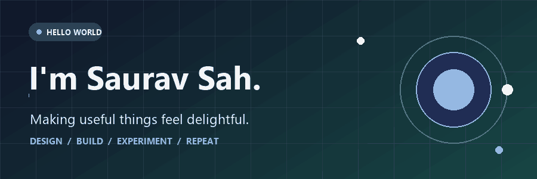

  

<h1 align="center">Hi, I'm Saurav 👋</h1>

  I build thoughtful tools for everyday life — from private money planning and healthier screen habits to creative tools for the web.

  <a href="#-things-ive-built">Explore my work</a> ·
  <a href="mailto:sauravsahbrj@gmail.com">Say hello</a>

---

### A little about me

I like the space where **useful**, **beautiful**, and **respectful of people's data** meet. My projects range from an offline personal finance app to a browser extension that processes camera signals locally. I care about the details people actually feel: a clear interaction, a calm interface, and a product that works.

### ✨ Things I've built

| Project | What it does |
| :--- | :--- |
| [**Paisa Planner**](https://github.com/sauravsah/Paisa-Planner) | A free, offline money planner for India. |
| [**ShubhBiodata**](https://github.com/sauravsah/shubhbiodata) | Create marriage biodata in 14 languages, with PDF, JPG, and video exports. [Try it live ↗](https://sauravsah.github.io/shubhbiodata/) |
| [**EyeCare Buddy**](https://github.com/sauravsah/eyecare-buddy) | A privacy-minded Chrome side panel for healthier screen habits. |
| [**Pixel Paper**](https://github.com/sauravsah/pixel-paper) | A digital newspaper where people can claim their own little piece of the page. |

### What I'm exploring

Building small, memorable products; making privacy a design choice; and turning practical ideas into interfaces people enjoy using.

  

